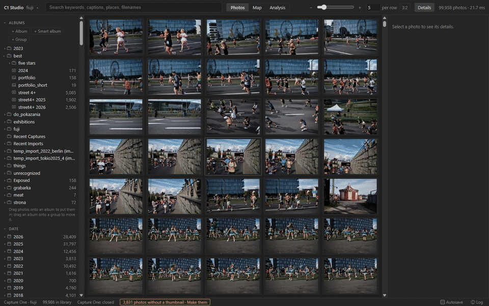
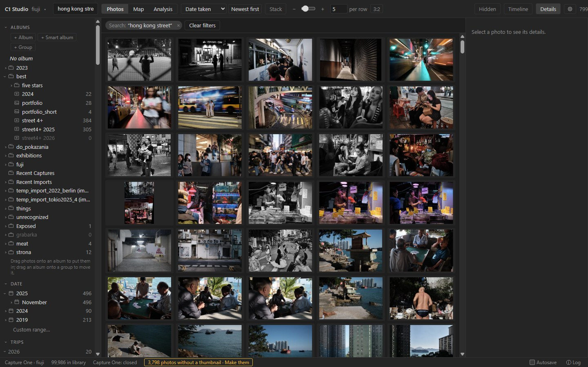
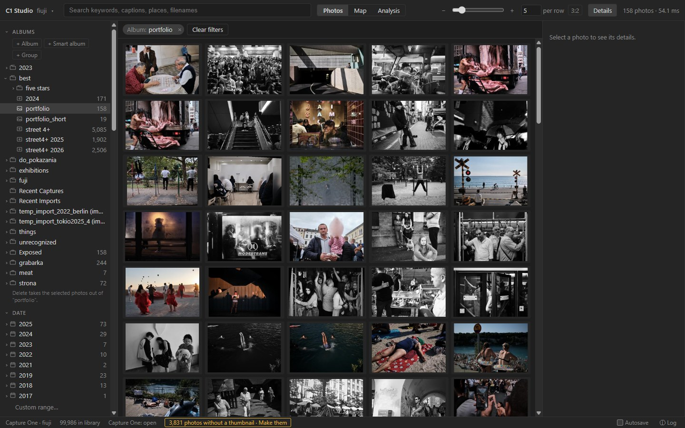
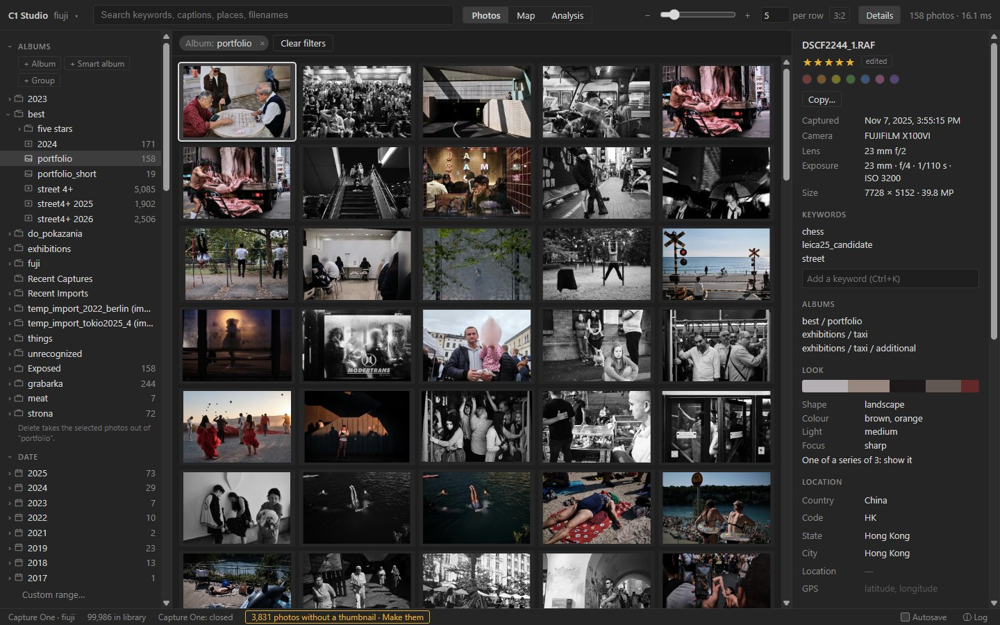
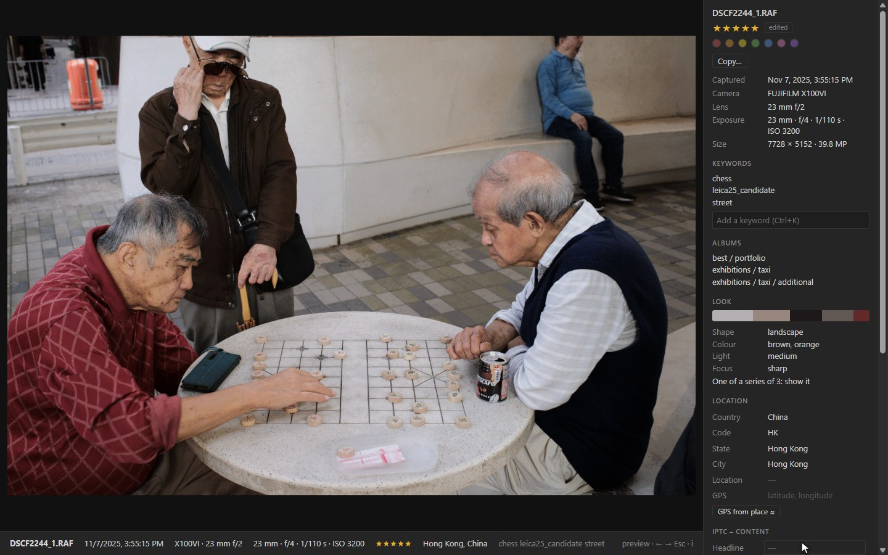
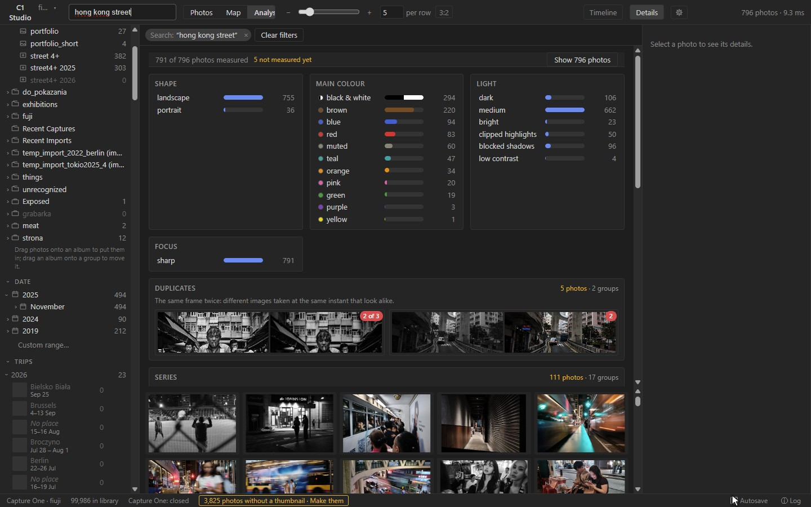
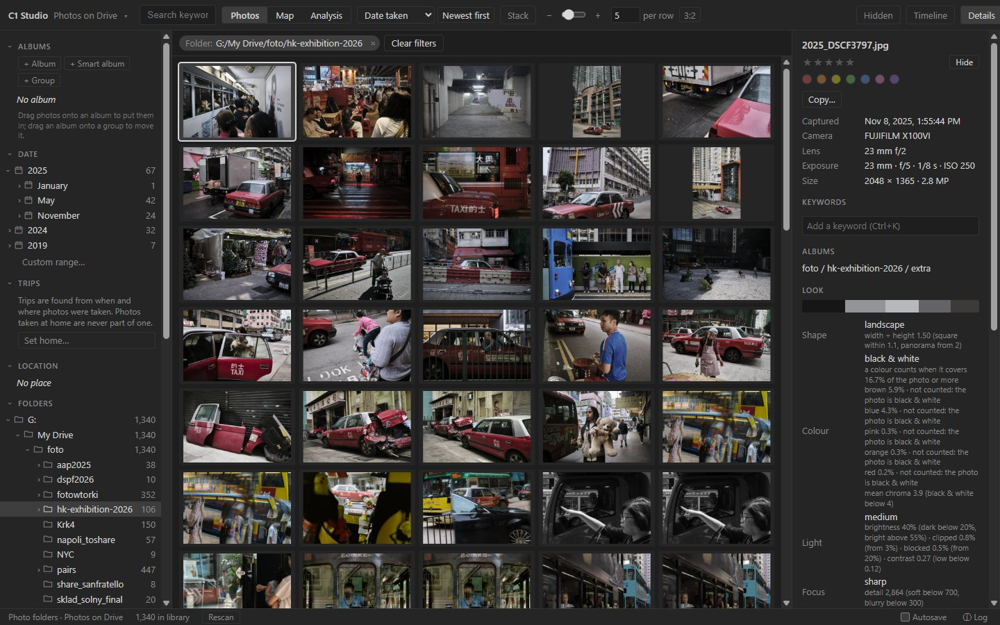
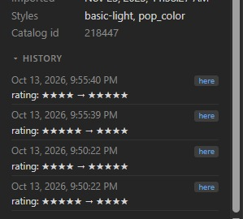

# C1 Studio

**A fast companion app for Capture One catalogs, and now for plain photo folders.**
Browse, search and tidy 100,000 photos in milliseconds, then send your edits back to
Capture One when you choose.

**New in 0.5.0:** a [trash](docs/FEATURES.md#delete-with-a-trash): **Delete** takes photos
out of every view, and nothing leaves the catalog or the drive until you empty it. Editing
in the full-screen viewer is fixed: stars and keywords land on the photo shown.

**New in 0.4.0:** open [photo folders](#photo-folders) (JPEG, PNG, TIFF and raw files,
on any drive) like a catalog, choose in the installer which kinds of source to offer, and
[refine places](docs/FEATURES.md#places-from-neighbours-in-time) from the photos taken
moments before and after.

[](https://github.com/sponsors/bartoszm)
[](https://buymeacoffee.com/bartoszmics)



C1 Studio reads your Capture One catalog and builds its own index next to it, so finding
and sorting photos never waits on Capture One. It never changes the catalog behind your
back: edits queue up in the app and are written only when you press *Write* (or turn
Autosave on), with a backup of the catalog made first.

Written in Rust (Tauri 2 + Svelte 5, tantivy + redb). Windows, Capture One 16.

## What it does

Each feature in motion: [docs/FEATURES.md](docs/FEATURES.md).

### Find anything, instantly

Combine albums, dates, folders, keywords, rating, colour tag, camera, lens and place with
free-text search over keywords, captions, places and file names. Every count in the
sidebar updates as you narrow down: below, 796 of 100,000 photos found in 12 ms. Sort by
date, rating, colour label, import, name, sharpness or brightness, either way, or put the
**best match** for the colours, light and focus you picked first.



### Browse and edit

A resizable grid, a details panel and a full-screen viewer, showing each photo as
Capture One renders it. Edit ratings, colour tags, keywords and
the keyword tree (rename, join, group), albums and smart albums, location, GPS and IPTC
fields, or copy fields from one photo to many. Press `h` to hide sensitive photos from
every view and count; Capture One never sees the mark. Press **Delete** to move photos to
the app's trash: they leave every view at once, and nothing reaches Capture One or the
drive until you empty it.



| Details | Viewer |
| --- | --- |
|  |  |

### See what your photos look like

Every photo is measured once: shape, main colours (by share, or by a vivid patch such as
a red coat on a grey street), brightness, clipped highlights, blocked shadows and focus.
Filter by them (any or all of a card's picks), see why a photo is in each class, and move
the lines in Settings with a live preview. Duplicates (the same moment shot twice) and
series (bursts) are found across the library, and **Stack** shows one photo per burst.



### Photo folders

Not everything is in a catalog. C1 Studio also opens plain folders of JPEG, PNG, TIFF
and camera raw files, from a disk, a NAS or a cloud drive, with the same search, map,
analysis and editing. EXIF, XMP and IPTC are read from the files; your edits are kept in
C1 Studio and written to the files only if you turn XMP export on. Photos keep their
edits when files are moved or renamed, and a drive that is not connected marks its photos
offline instead of losing them. Thumbnails go where you choose: one central folder, a
folder under each root (so they travel with an external drive), beside each photo, or a
pattern of your own.



### On the map

Photos with GPS are clustered on a map that works as a filter: pan and zoom to narrow the
grid, box-select a region, search for a place or type coordinates (`44°58′N 14°45′E`), or
drag photos to set their position. Import a GPX track to place a whole trip at once.

Photos with a city, region or country but no GPS show too, marked ≈, at that place while
the map is zoomed out about as far as the name reaches. Place names are found offline in
a built-in [GeoNames](https://www.geonames.org/) gazetteer (CC BY 4.0); the few it lacks
are looked up online once. Photos with no location wait in a tray under the map to be
dragged on, or get positions from the photos taken just before and after them.
**Refine** makes rough places more specific (Kraków → Kraków › Stare Miasto) and moves ≈
positions to the GPS of photos taken moments apart. A new position can fill in the
photo's city, region and country.

### History



Every change to the catalog is recorded from now on, whether it was made here, in
Capture One, by a GPX import or by restoring a backup. The details panel shows each
photo's history. This is the groundwork for browsing the catalog as it was on any date.

<br clear="right">

### Also

- **`c1cat`**: the same library from the command line: find, count, facets, edits and
  rendering previews to JPEG. See [docs/CLI.md](docs/CLI.md).
- **Backups**: every write is preceded by a backup of the catalog, and any backup can be
  restored from the app.

Place data from [GeoNames](https://www.geonames.org/), licensed under
[CC BY 4.0](https://creativecommons.org/licenses/by/4.0/).

## Support the project

If C1 Studio saves you time, you can support its development on
[GitHub Sponsors](https://github.com/sponsors/bartoszm) or
[Buy Me a Coffee](https://buymeacoffee.com/bartoszmics). Thank you!

## Status

Developed against a 100,000-photo catalog. Reading is tested on Capture One 16.5 and 16.8
catalogs; writing on 16.8 only (other versions open read-only). Capture One may change
its catalog format in any release: keep backups, and expect rough edges.

C1 Studio is not affiliated with or endorsed by Capture One.

Licensed under the [MIT License](LICENSE).

The user guide is [docs/GUIDE.md](docs/GUIDE.md); the plan is in
[docs/PLAN.md](docs/PLAN.md) and the progress log in [docs/PROGRESS.md](docs/PROGRESS.md).

## Install

Download `C1.Studio_<version>_x64-setup.exe` from the
[latest release](https://github.com/bartoszm/c1-studio/releases/latest) and run it. It
installs for the current user (no administrator rights) and adds C1 Studio to the Start
menu. The installer is not code-signed, so Windows may say it is from an unknown
publisher: choose *More info* → *Run anyway*. Uninstall from *Settings → Apps*.

The installer asks which kinds of photo source to offer: Capture One catalogs, photo
folders or both (`/KINDS=capture-one,folders` for a silent install). The first time,
nothing is open: choose a Capture One catalog (the `.cocatalogdb` file) or photo folders
from the source menu at the top left. Catalogs from Capture One 16.8 are read and
written, 16.5 read only; see [docs/GUIDE.md](docs/GUIDE.md).

## Build

```powershell
cd app
pnpm install
pnpm tauri dev                          # live-reloading window
pnpm tauri build --debug --no-bundle    # target\debug\c1studio.exe
pnpm tauri build                        # the installer: target\release\bundle\nsis\*-setup.exe
```

The app opens a catalog given on the command line (`c1studio.exe C:\c1_catalogs\mine`),
then the one opened last. Library data lives in `%LOCALAPPDATA%\c1studio\<catalog id>\`.

### The command line

```powershell
cargo build --release -p c1cat
$c1 = '.\target\release\c1cat.exe'
& $c1 sync                                     # first run indexes the whole catalog
& $c1 find --rating '>=4' --keyword street --limit 20
& $c1 count --year 2026 --unkeyworded
& $c1 facets --year 2026 --dims rating,camera,keyword_tree
& $c1 image --tier preview -o out --rating 5 --limit 5   # render previews to JPEG
& $c1 bench                                    # speed gate on 250k synthetic photos
```

The catalog is located from `--catalog`, then `C1_CATALOG`, then
`%APPDATA%\c1studio\config.json` (`{"catalog": "C:\\c1_catalogs\\mine\\mine.cocatalogdb"}`).

### Layout

```
crates/c1model/    canonical photo model + the PhotoSource contract + conformance checks
crates/source-c1/  Capture One catalog as a PhotoSource
crates/c1index/    the library: redb store + tantivy index, filters, facet counts, sync, change log
crates/c1image/    display-ready pixels: thumbnails, white-balanced JPEG-XL previews, raw-embedded JPEGs
crates/c1analysis/ what photos look like: colour, light, focus, duplicates, series
crates/c1geo/      places offline: a GeoNames gazetteer (tools/gazetteer builds it), typed coordinates
crates/c1cat/      CLI over the library
app/               the desktop app: Tauri 2 (app/src-tauri) + Svelte 5 (app/src)
legacy/c1cat-py/   the original Python c1cat, kept as the oracle for differential tests
```

### Releasing

Bump `version` in `app/src-tauri/tauri.conf.json` and in `[workspace.package]` of
`Cargo.toml`, commit, then `git tag vX.Y.Z` and `git push origin vX.Y.Z`. The Release
workflow builds the installer and attaches it to a draft release; publish the draft on
GitHub. A tag that does not match the version fails the build.

### Test

```powershell
cargo test --workspace
cargo test -p source-c1 --test live -- --ignored   # against a real catalog, read-only
python tools/difftest/difftest.py                   # Rust vs the Python oracle in WSL, same catalog
```
