# C1 Studio features

What C1 Studio does, one feature at a time, each with a short recording of the app on a
real catalog of 100,000 photos. The [user guide](GUIDE.md) has the details.

New in 0.5.0: [delete, with a trash](#delete-with-a-trash). New in 0.4.0:
[photo folders](#photo-folders) and [places from neighbours in time](#places-from-neighbours-in-time).

- [Find anything, instantly](#find-anything-instantly)
- [Photo folders](#photo-folders)
- [Browse](#browse)
- [Sort](#sort)
- [The best match first](#the-best-match-first)
- [Edit, then write](#edit-then-write)
- [Hide sensitive photos](#hide-sensitive-photos)
- [Delete, with a trash](#delete-with-a-trash)
- [The keyword tree](#the-keyword-tree)
- [Albums and smart albums](#albums-and-smart-albums)
- [See what your photos look like](#see-what-your-photos-look-like)
- [Duplicates, bursts and stacking](#duplicates-bursts-and-stacking)
- [On the map](#on-the-map)
- [Places from neighbours in time](#places-from-neighbours-in-time)
- [Trips and the timeline](#trips-and-the-timeline)
- [Write, history and backups](#write-history-and-backups)

## Find anything, instantly

Type to search keywords, captions, places and file names, and narrow down with albums,
dates, folders, keywords, rating, colour tag, camera, lens and place. Every count in the
sidebar follows as you go, and each filter shows as a chip above the grid. Queries take
milliseconds, however big the catalog.

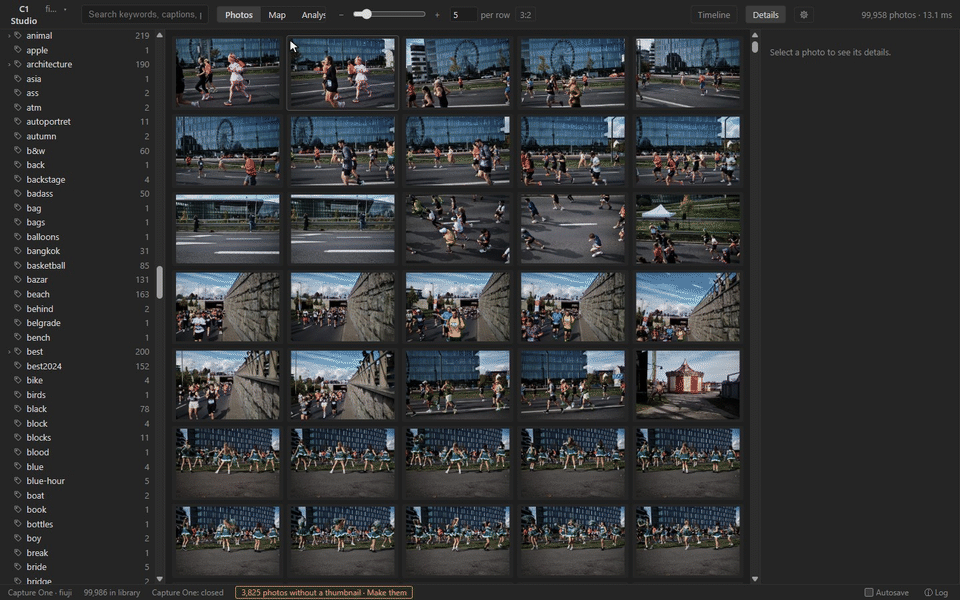

[In the guide: Finding photos](GUIDE.md#finding-photos)

## Photo folders

*New in 0.4.0.* Open plain folders of JPEG, PNG, TIFF and camera raw files the way you
open a Capture One catalog: here, 1,350 photos in a Google Drive folder. EXIF, XMP and
IPTC are read from the files, and your ratings, keywords and places are kept in C1
Studio's own store. They go into the files only if you turn XMP export on. A photo keeps
its edits when its file is moved or renamed, and a drive that is not connected marks its
photos offline instead of losing them. The installer, and *Kinds of source…* in the
source menu, choose whether the app offers catalogs, folders or both.

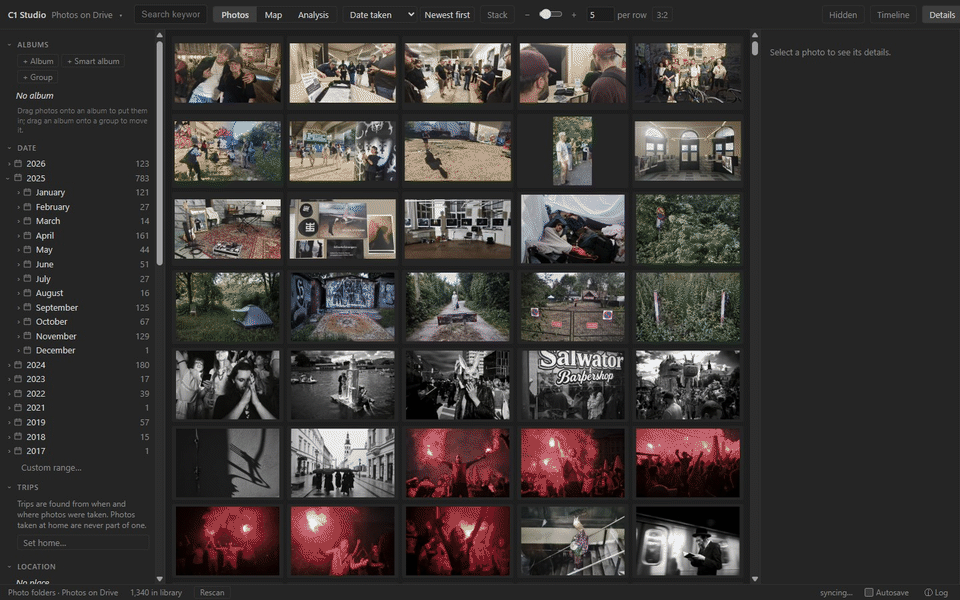

[In the guide: Photo folders](GUIDE.md#photo-folders)

## Browse

A resizable grid, a details panel with everything about the photo, and a full-screen
viewer, showing each photo as Capture One renders it: its thumbnails and previews, with
your edits and crop.

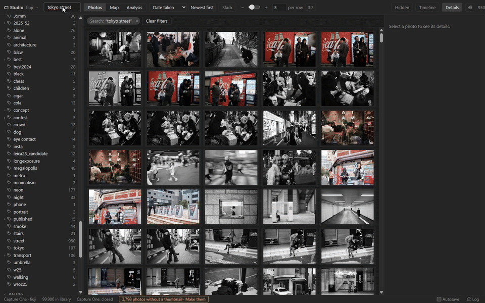

[In the guide: Browsing](GUIDE.md#browsing)

## Sort

Sort by date taken, rating, colour label, import, file name, sharpness or brightness,
with a button that says which way ("Newest first", "Lowest first") and turns it round.

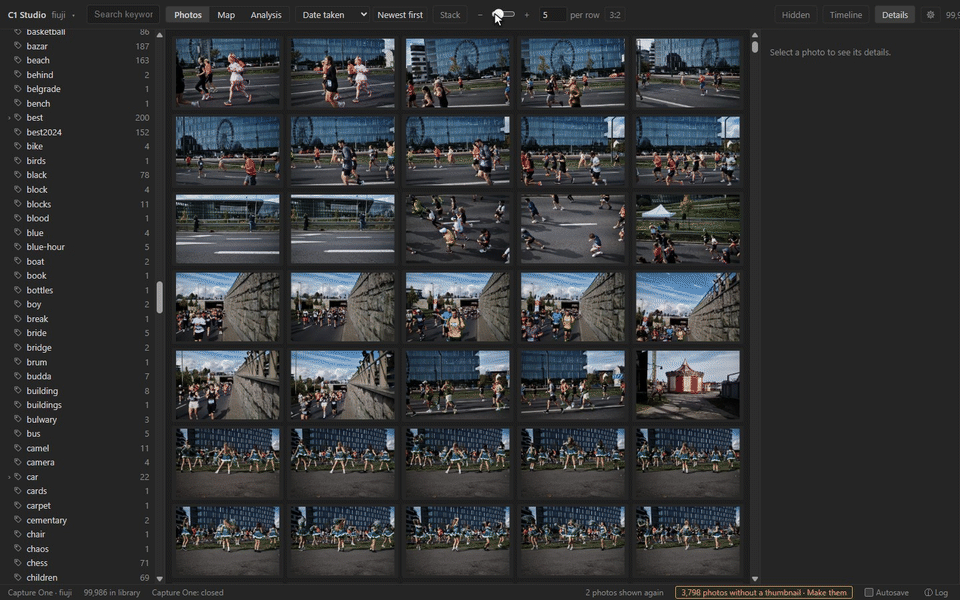

[In the guide: Sorting](GUIDE.md#sorting)

## The best match first

Pick colours, light or focus and **Best match** puts the photos that fit them best
first: the reddest and bluest, the darkest, the sharpest. With picks in several cards the
scores are averaged; *worst match first* turns it round. The ranking is part of the
search, so it is as fast as any other order.

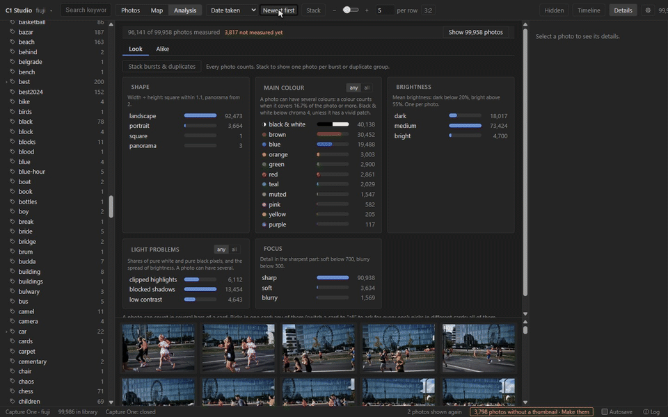

[In the guide: Sorting](GUIDE.md#sorting)

## Edit, then write

Rate, colour-tag and keyword one photo or many, with a key or in the details panel.
Location, GPS and IPTC fields too, and copying fields from one photo to others. Edits
show at once and wait in a queue: nothing reaches Capture One until you write them, or
Autosave does. Ctrl+Z undoes any of them.

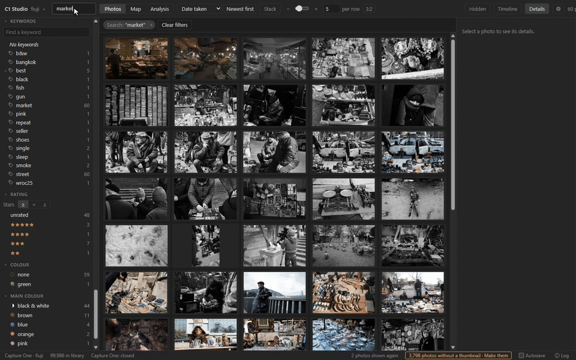

[In the guide: Editing](GUIDE.md#editing)

## Hide sensitive photos

Press `h` to keep photos out of every view and every count: the grid, the map, the
timeline, trips and the analysis. *Hidden* in the header shows them again, marked, and
`h` brings them back. The mark is C1 Studio's own: Capture One never sees it.

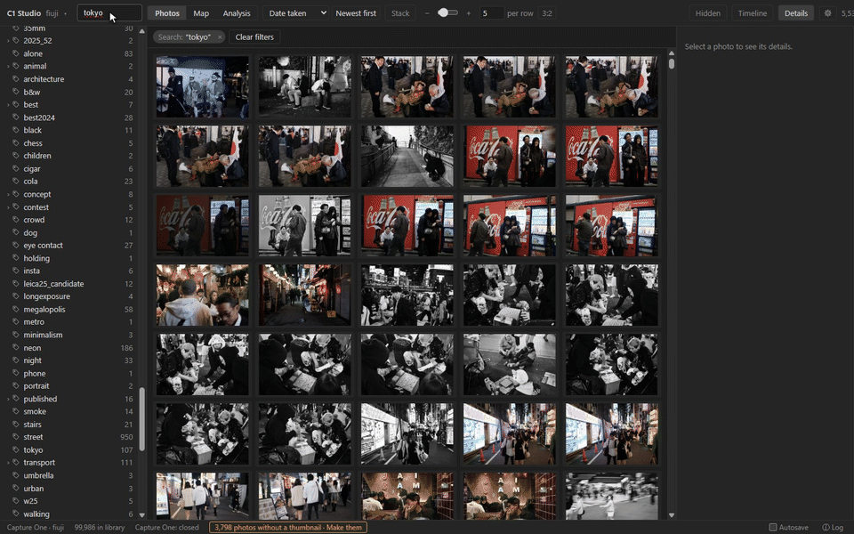

[In the guide: Hidden photos](GUIDE.md#hidden-photos)

## Delete, with a trash

**Delete** moves photos to C1 Studio's trash, out of every view; Ctrl+Z or *Restore* brings
them back. Nothing is deleted until you empty the trash: then a photo folder's files go to
the Windows Recycle Bin, and a Capture One catalog marks the images deleted, so they show
in Capture One's own Trash.

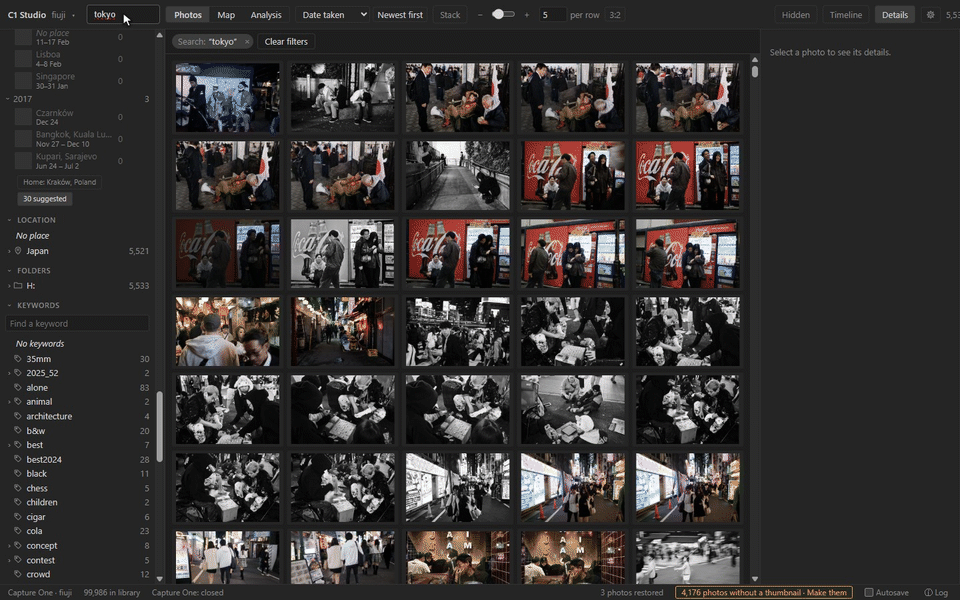

[In the guide: Trash](GUIDE.md#trash)

## The keyword tree

Find a keyword among thousands, and right-click it to rename it, join it with others,
group it under a parent, or ungroup it. Every photo carrying it follows, as one edit.

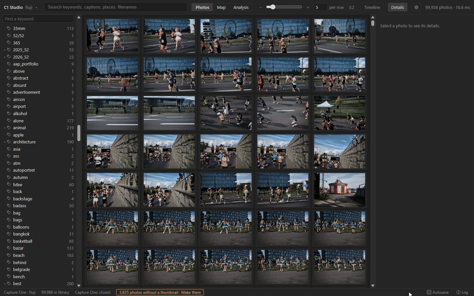

[In the guide: Keyword tree](GUIDE.md#keyword-tree)

## Albums and smart albums

Make albums, smart albums and groups, drag photos into albums and albums into groups.
A smart album is a rule (keyword, rating, year), so it holds whatever matches it, now and
later, and is counted by it.

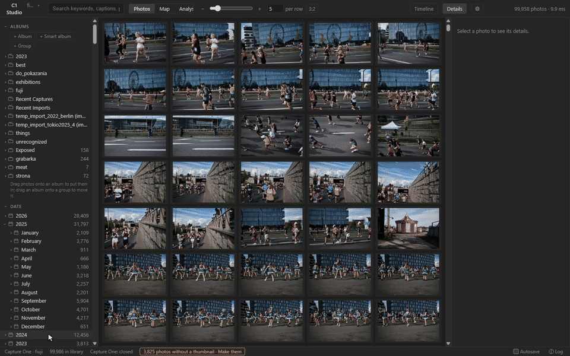

[In the guide: Albums](GUIDE.md#albums)

## See what your photos look like

Every photo is measured once, from its thumbnail: its shape, main colours, brightness,
light problems (clipped highlights, blocked shadows, low contrast) and focus. Each value
is a filter, and each card says what it measures. Picks in a card mean any of them, or,
switched to *all*, every one: red **and** blue. A colour counts when it covers a share of
the photo, or when the photo has a vivid patch of it (a red coat on a grey street), as
you choose in Settings, where every line can be moved and the counts preview as you go.
The details panel says why a photo is red, bright or sharp.

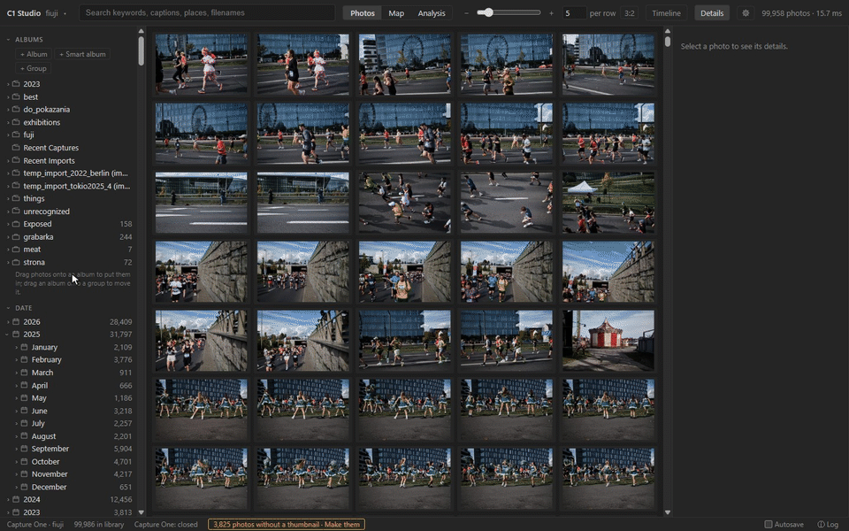

[In the guide: Look](GUIDE.md#look)

## Duplicates, bursts and stacking

Duplicates (one moment saved twice) and series (bursts) are found across the whole
library and listed together, sorted by size, date or sharpness. **Stack** shows one photo
per burst in the grid, its sharpest, without ever hiding a frame that matches your
filter when its sharpest does not.

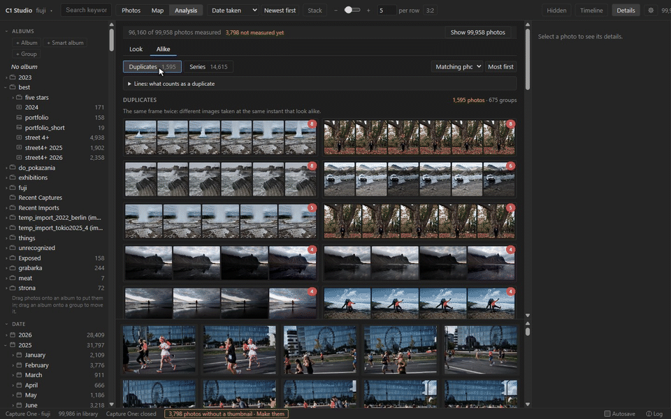

[In the guide: Look](GUIDE.md#look)

## On the map

Photos with GPS are clustered on a map that works as a filter: pan and zoom, and the grid
shows what is in view, or Shift+drag a box. Find places by name or coordinates. Photos
with only a city or country show at that place, marked ≈. Drag photos onto the map to
place them, import a GPX track, or take positions from the photos shot just before and
after. Drag the line under the map to give the photo strip more room.

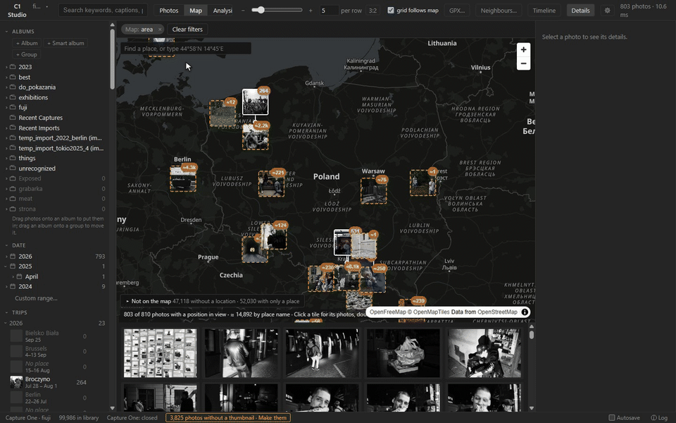

[In the guide: Map](GUIDE.md#map)

## Places from neighbours in time

*New in 0.4.0.* Photos taken moments apart were taken in the same place. **Neighbours…**
fills in the photos with no position from the ones shot just before and after. Its
**Refine** side improves rough ones: a photo placed only in *London* takes
*London › Barbican* from its neighbour, and a ≈ position (from the place's name)
moves to the GPS of a photo taken within two minutes, but only if it lies in the photo's
own place. You see the counts and every from → to before anything changes, and Ctrl+Z
undoes it.

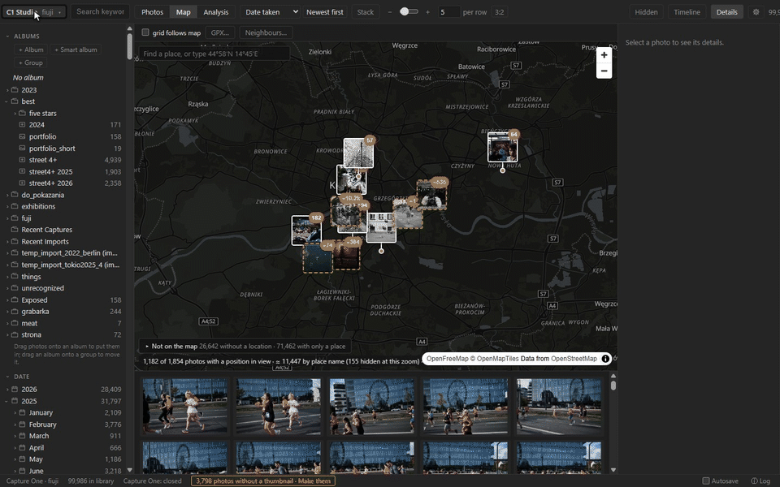

[In the guide: Map](GUIDE.md#map)

## Trips and the timeline

Trips are found from when and where the photos were taken, and named after their places.
Rename, merge, split or keep them, or make an album of one. The timeline shows photos per
day, week or month with the trips under the bars: drag across it to pick days.

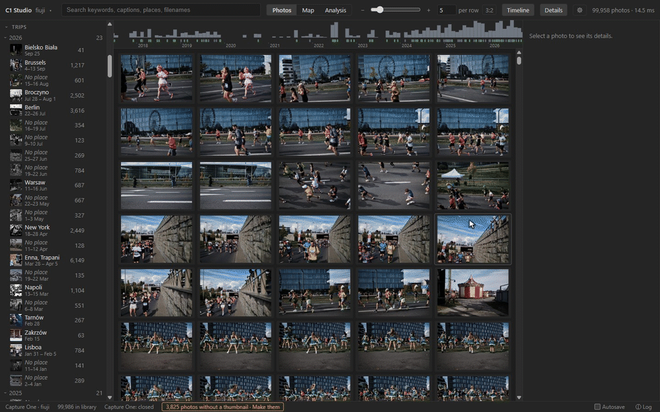

[In the guide: Trips and the timeline](GUIDE.md#trips-and-the-timeline)

## Write, history and backups

Writing makes a backup of the catalog first, and any backup can be restored from the app.
Every change to the catalog is recorded, whether it was made here, in Capture One, by a
GPX import or by restoring a backup, and the details panel shows each photo's history.

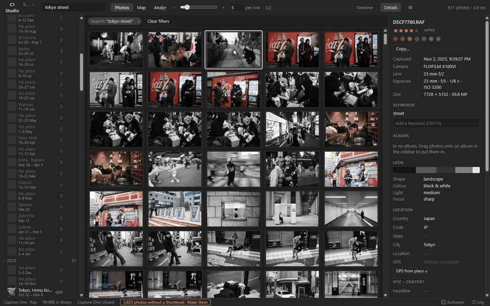

[In the guide: Writing to Capture One](GUIDE.md#writing-to-capture-one)

---

The recordings are made by scripts that drive the app, so they can be made again when it
changes: see [tools/record](../tools/record/README.md).
