# C1 Studio features

What C1 Studio does, one feature at a time, each with a short recording of the app on a
real catalog of 100,000 photos. The [user guide](GUIDE.md) has the details.

New in 0.11.0: [choose the best of a burst](#choose-the-best-of-a-burst),
[keywords from a model on your own computer](#describe-photos-with-ai),
[several keywords at once](#edit-then-write) and [the keyword tree by use](#the-keyword-tree).
New in 0.10.0: [filters: only, add, leave out, or](#filters-only-add-leave-out-or) and
[search by camera, lens, exposure, file and shape](#find-anything-instantly). New in 0.9.0:
[find where photos were taken](#find-where-photos-were-taken). New in 0.8.0: [compare photos](#compare-photos), [a composition grid](#a-composition-grid)
and [variants](#variants). New in 0.7.0: [the selection through filters, Back and Forward](#the-selection-through-filters-back-and-forward),
[photos around a photo](#photos-around-a-photo) and [AI suggestions corrected, and lessons](#correct-the-ai-and-teach-it). New in 0.6.0: [describe photos with AI](#describe-photos-with-ai),
[History](#history-the-catalog-over-time) and [plus codes, map and grid in sync](#no-location-plus-codes-map-and-grid-in-sync). New in 0.5.0: [delete, with a trash](#delete-with-a-trash). New in 0.4.0:
[photo folders](#photo-folders) and [places from neighbours in time](#places-from-neighbours-in-time).

- [Find anything, instantly](#find-anything-instantly)
- [Filters: only, add, leave out, or](#filters-only-add-leave-out-or)
- [Photo folders](#photo-folders)
- [Browse](#browse)
- [Compare photos](#compare-photos)
- [Choose the best of a burst](#choose-the-best-of-a-burst)
- [A composition grid](#a-composition-grid)
- [Variants](#variants)
- [The selection through filters, Back and Forward](#the-selection-through-filters-back-and-forward)
- [Photos around a photo](#photos-around-a-photo)
- [Sort](#sort)
- [The best match first](#the-best-match-first)
- [Edit, then write](#edit-then-write)
- [Hide sensitive photos](#hide-sensitive-photos)
- [Delete, with a trash](#delete-with-a-trash)
- [The keyword tree](#the-keyword-tree)
- [Albums and smart albums](#albums-and-smart-albums)
- [See what your photos look like](#see-what-your-photos-look-like)
- [Duplicates, bursts and stacking](#duplicates-bursts-and-stacking)
- [On the map](#on-the-map)
- [No location, plus codes, map and grid in sync](#no-location-plus-codes-map-and-grid-in-sync)
- [Places from neighbours in time](#places-from-neighbours-in-time)
- [Trips and the timeline](#trips-and-the-timeline)
- [Write, history and backups](#write-history-and-backups)
- [History: the catalog over time](#history-the-catalog-over-time)
- [Describe photos with AI](#describe-photos-with-ai)
- [Correct the AI, and teach it](#correct-the-ai-and-teach-it)

## Find anything, instantly

Type to search keywords, captions, places and file names, and narrow down with albums,
dates, folders, keywords, rating, colour tag, camera, lens, format, orientation and
place. Tokens in the search box reach the exposure and the file: `iso:>3200 f:<2
orient:portrait format:raw size:>30mb` (`?` beside the box lists them all), and Enter
turns them into filters. Every count in the sidebar follows as you go, and the filter
bar above the grid says what is picked. Queries take milliseconds, however big the
catalog.

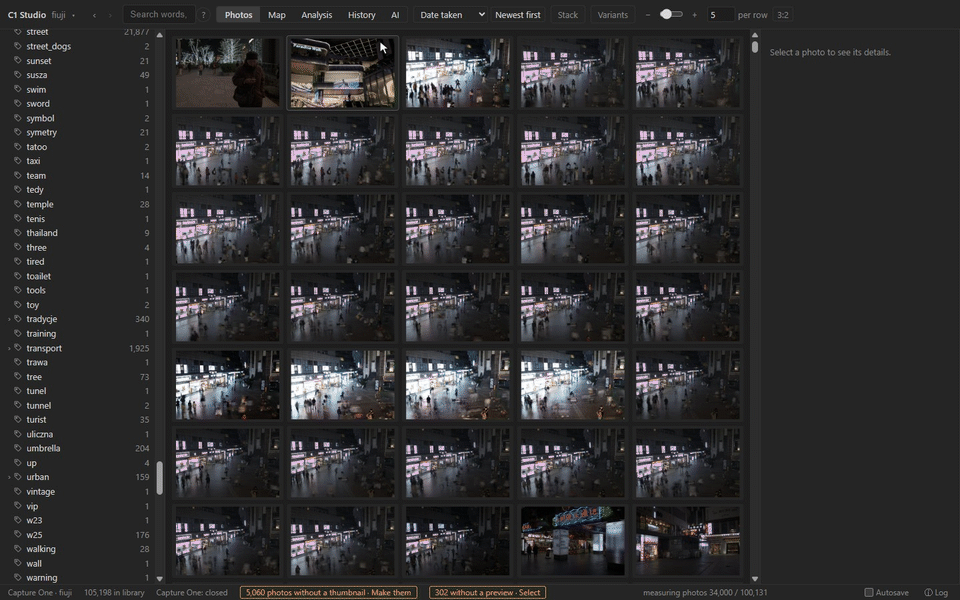

[In the guide: Finding photos](GUIDE.md#finding-photos)

## Filters: only, add, leave out, or

One click, one meaning, in every section. A click shows only that value; **Ctrl+click**
adds it (*X-T5 or X100VI*); **Alt+click** leaves it out (*Poland except Kraków*, red and
struck through); **Shift+click** makes it an alternative to other sections (*Kraków or
black & white*). The filter bar reads as a sentence, a pill per section with *and*
between them. Click a value in it to leave it out or show it again, and click *and* /
*or* to switch: two keywords, all or any of them; two pills, both or either. `?` beside
the search box has it all.

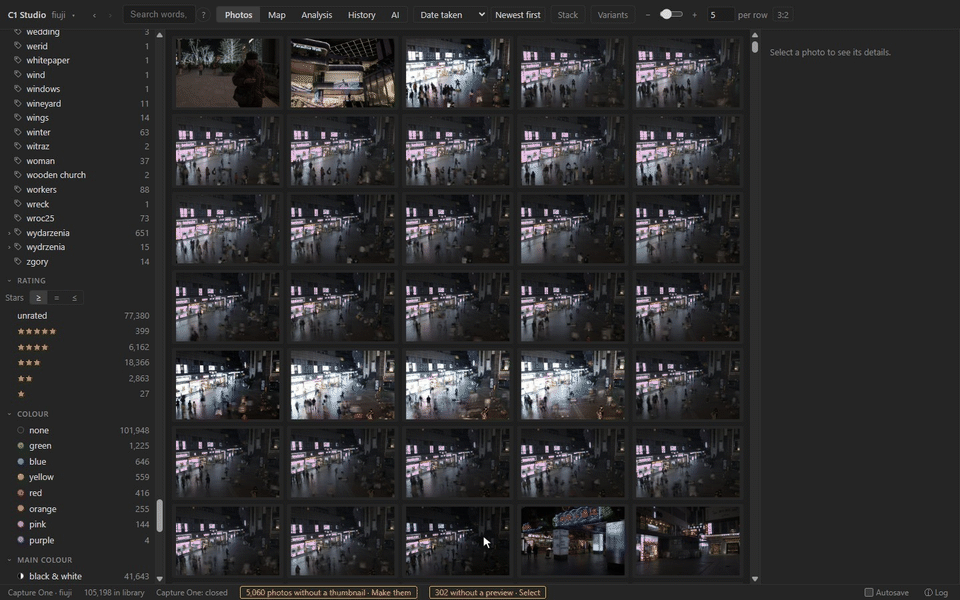

[In the guide: Finding photos](GUIDE.md#finding-photos)

## Photo folders

*New in 0.4.0.* Open plain folders of JPEG, PNG, TIFF and camera raw files the way you
open a Capture One catalog: here, 1,350 photos in a Google Drive folder. EXIF, XMP and
IPTC are read from the files, and your ratings, keywords and places are kept in C1
Studio's own store. They go into the files only if you turn XMP export on. A photo keeps
its edits when its file is moved or renamed, and a drive that is not connected marks its
photos offline instead of losing them. The installer, and *Kinds of source…* in the
source menu, choose whether the app offers catalogs, folders or both.

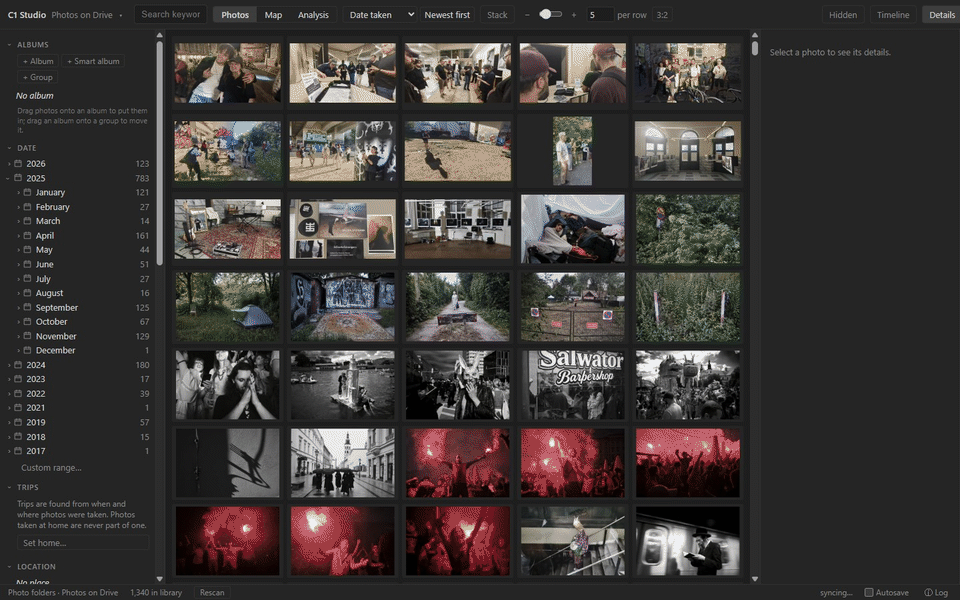

[In the guide: Photo folders](GUIDE.md#photo-folders)

## Browse

A resizable grid, a details panel with everything about the photo, and a full-screen
viewer, showing each photo as Capture One renders it: its thumbnails and previews, with
your edits and crop. Stars and colour tags show on the tiles; right-click photos to rate,
tag, keyword, add to an album or trash them; `?` lists every key.

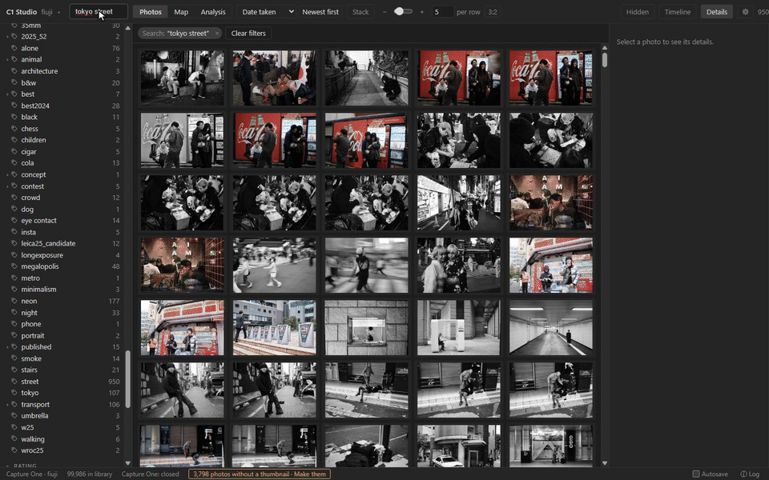

[In the guide: Browsing](GUIDE.md#browsing)

## Compare photos

*New in 0.8.0.* Pick 2 to 4 photos and press `c`: they show side by side, zoomed and
moved together or apart, with their exposure, stars and the focus measured under each,
the sharpest marked. Rate, tag or delete the active one without leaving. Two photos can
be **split** by a line you drag, **overlaid**, shown as their **difference**, or
**blinked** one over the other.

[In the guide: Browsing](GUIDE.md#browsing)

## A composition grid

*New in 0.8.0.* In the viewer, `g` lays a grid over the photo: thirds, the golden ratio,
quarters, diagonals, golden triangles or the Fibonacci spiral, and `o` turns the last
two. It stays on for the next photos.

[In the guide: Browsing](GUIDE.md#browsing)

## Variants

*New in 0.8.0.* A number on a tile says how many variants its image has in Capture One.
**Variants** in the header shows one tile per image; click the number, or press `v`, to
see all of one image's variants.

[In the guide: Browsing](GUIDE.md#browsing)

## The selection through filters, Back and Forward

*New in 0.7.0.* Change the filter and the picked photos stay picked, wherever the new one
still shows them; the footer says how many it leaves out, with **Show them**. When an
edit empties the filter (Kraków photos given Warszawa as their city), the filter follows
the photos to their new values instead of leaving an empty grid. **‹ ›** in the header, or
Alt+← and Alt+→, go back and forward through the filters, each with its picks.

[In the guide: Finding photos](GUIDE.md#finding-photos)

## Photos around a photo

*New in 0.7.0.* *Around* in the details panel shows the photos taken near this one: its
**shoot** (one after another, no gap over 30 minutes), ±15 minutes, ±1 hour, ±3 hours or
the whole day, with the photo still picked. Shift+click picks them in the grid instead,
and `t` shows the shoot of the focused photo.

[In the guide: Finding photos](GUIDE.md#finding-photos)

## Sort

Sort by date taken, rating, colour label, import, file name, sharpness or brightness,
with a button that says which way ("Newest first", "Lowest first") and turns it round.

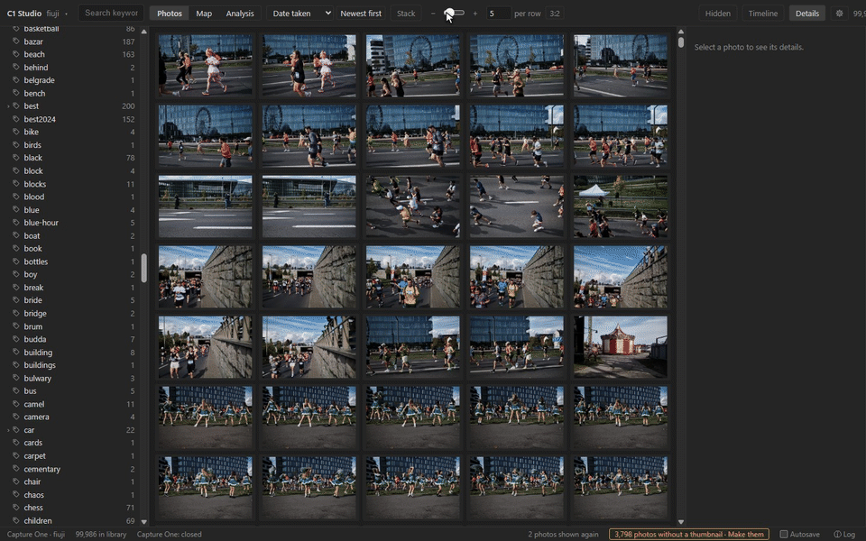

[In the guide: Sorting](GUIDE.md#sorting)

## The best match first

Pick colours, light or focus and **Best match** puts the photos that fit them best
first: the reddest and bluest, the darkest, the sharpest. With picks in several cards the
scores are averaged; *worst match first* turns it round. The ranking is part of the
search, so it is as fast as any other order.

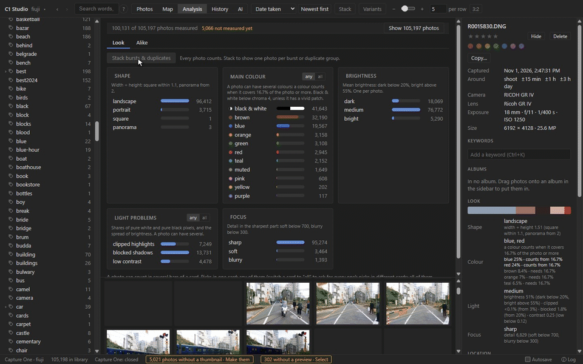

[In the guide: Sorting](GUIDE.md#sorting)

## Edit, then write

Rate, colour-tag and keyword one photo or many, with a key or in the details panel. Type
several keywords at once, split by `;`, or paste a list: Enter adds them all as one edit.
Location, GPS and IPTC fields too, and copying fields from one photo to others. Edits
show at once and wait in a queue: nothing reaches Capture One until you write them, or
Autosave does. Ctrl+Z undoes any of them.

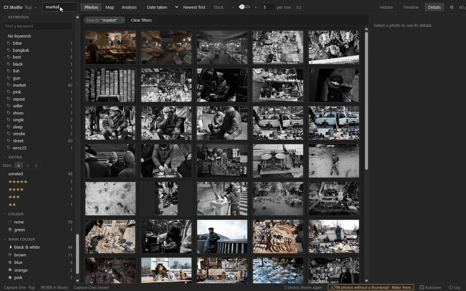

[In the guide: Editing](GUIDE.md#editing)

## Hide sensitive photos

Press `h` to keep photos out of every view and every count: the grid, the map, the
timeline, trips and the analysis. *Hidden* in the header shows them again, marked, and
`h` brings them back. The mark is C1 Studio's own: Capture One never sees it.

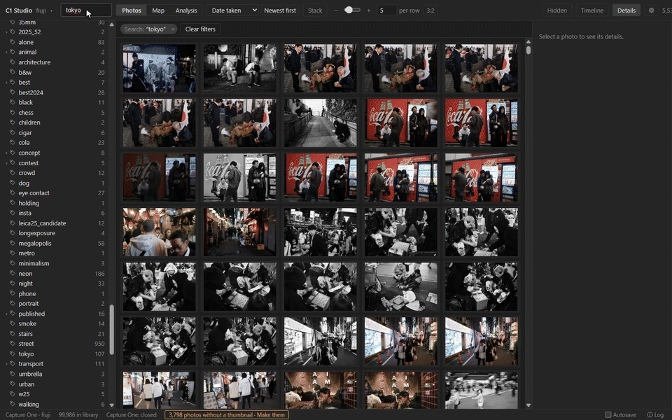

[In the guide: Hidden photos](GUIDE.md#hidden-photos)

## Delete, with a trash

**Delete** moves photos to C1 Studio's trash, out of every view; Ctrl+Z or *Restore* brings
them back. Nothing is deleted until you empty the trash: then a photo folder's files go to
the Windows Recycle Bin, and a Capture One catalog marks the images deleted, so they show
in Capture One's own Trash.

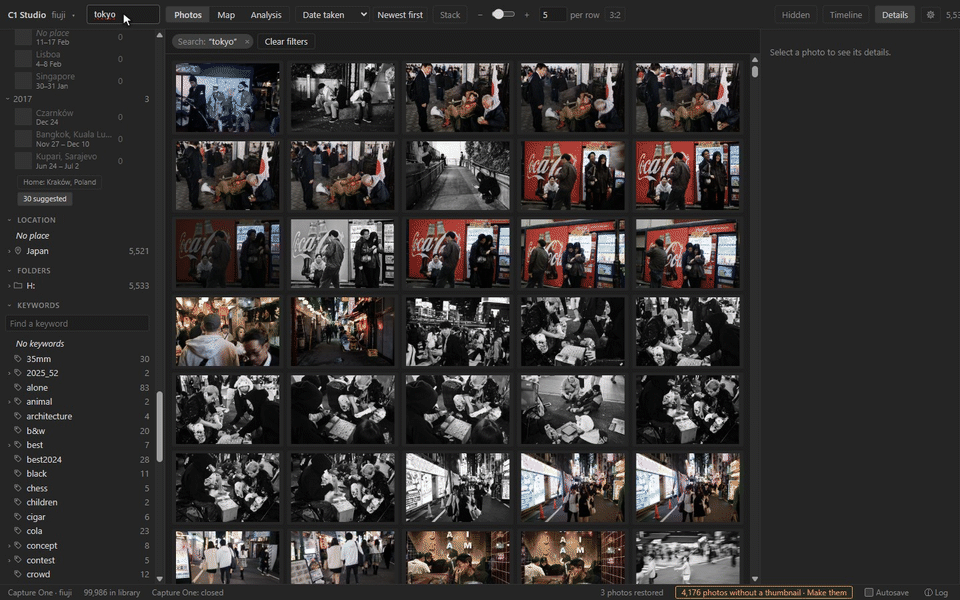

[In the guide: Trash](GUIDE.md#trash)

## The keyword tree

Find a keyword among thousands, and right-click it to rename it, join it with others,
group it under a parent, or ungroup it. Every photo carrying it follows, as one edit.
Sort the tree by most used, and hide keywords used only once or twice until you need them.

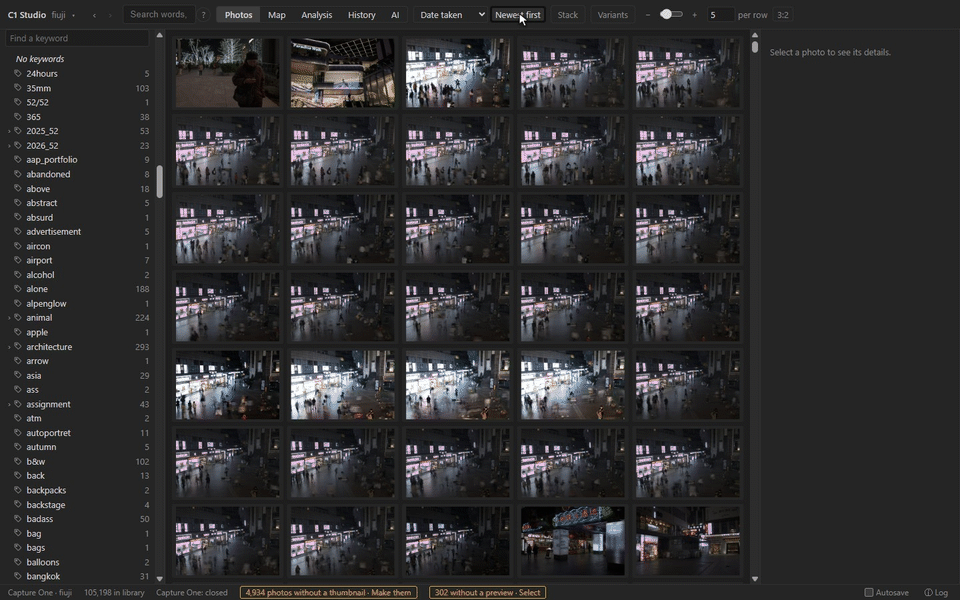

[In the guide: Keyword tree](GUIDE.md#keyword-tree)

## Albums and smart albums

Make albums, smart albums and groups, drag photos into albums and albums into groups.
A smart album is a rule (keyword, rating, year), so it holds whatever matches it, now and
later, and is counted by it.

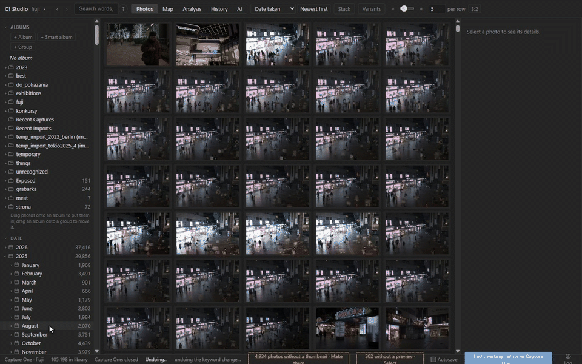

[In the guide: Albums](GUIDE.md#albums)

## See what your photos look like

Every photo is measured once, from its thumbnail: its shape, main colours, brightness,
light problems (clipped highlights, blocked shadows, low contrast) and focus. Each value
is a filter, and each card says what it measures. Picks in a card mean any of them, or,
switched to *all*, every one: red **and** blue. A colour counts when it covers a share of
the photo, or when the photo has a vivid patch of it (a red coat on a grey street), as
you choose in Settings, where every line can be moved and the counts preview as you go.
The details panel says why a photo is red, bright or sharp.

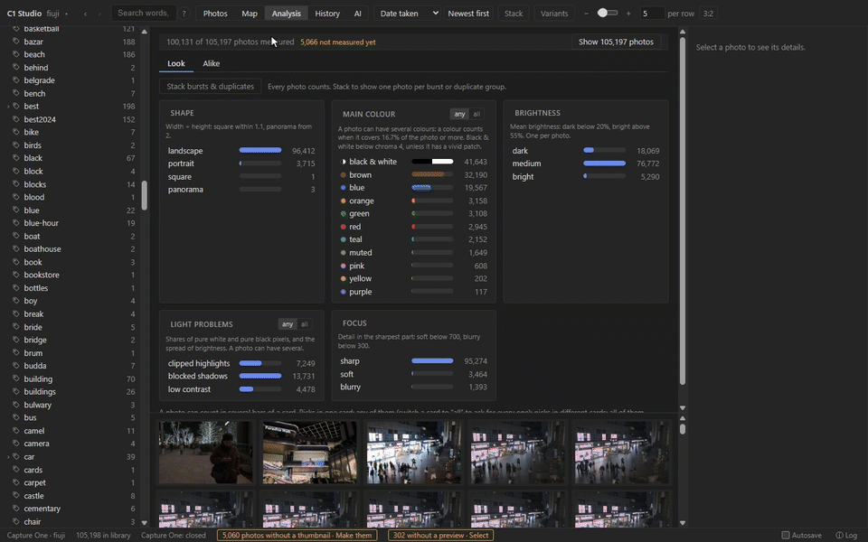

[In the guide: Look](GUIDE.md#look)

## Duplicates, bursts and stacking

Duplicates (one moment saved twice) and series (bursts) are found across the whole
library and listed together, sorted by size, date or sharpness. **Stack** shows one photo
per burst in the grid, its sharpest, without ever hiding a frame that matches your
filter when its sharpest does not.

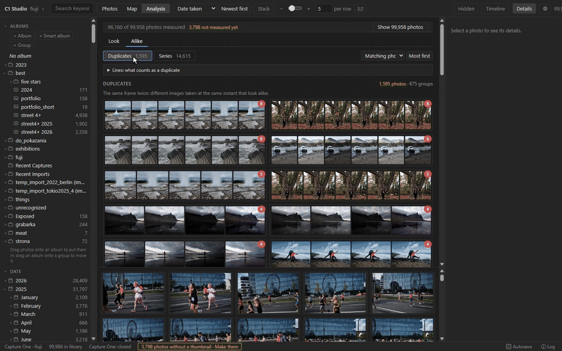

[In the guide: Look](GUIDE.md#look)

## Choose the best of a burst

**Best of…** (or `b`) goes through the series and duplicate groups among the photos shown,
one at a time, or, with two photos or more picked, chooses among those as one group. The
group's photos are side by side, with the comparison's zoom and modes, and the ones to
keep are suggested: a higher rating first, sharp before blurry, then the best composed
(where the subject sits, an edge cutting it, busy edges, a tilted horizon, measured from
the pixels), then the sharpest. *Keep: 1 · 2 · 3 · Auto* says how many are suggested;
*Auto* adds to the best up to two more that are as good and are other pictures. *Look* has
the local model weigh composition, moment and mood; *Ask AI* has Claude or Gemini compare
the frames and say what sets each apart. Enter keeps the active photo and the marked ones
and deals with the rest (to the trash, hidden, rated or tagged: your choice), then shows
the next group. Each pick is one Ctrl+Z, and a photo you keep stands for its group when
Stack is on.

[In the guide: Choosing the best of alike photos](GUIDE.md#choosing-the-best-of-alike-photos)

## On the map

Photos with GPS are clustered on a map that works as a filter: pan and zoom, and the grid
shows what is in view, or Shift+drag a box. Find places by name or coordinates. Photos
with only a city or country show at that place, marked ≈. Drag photos onto the map to
place them, import a GPX track, or take positions from the photos shot just before and
after. Drag the line under the map to give the photo strip more room.

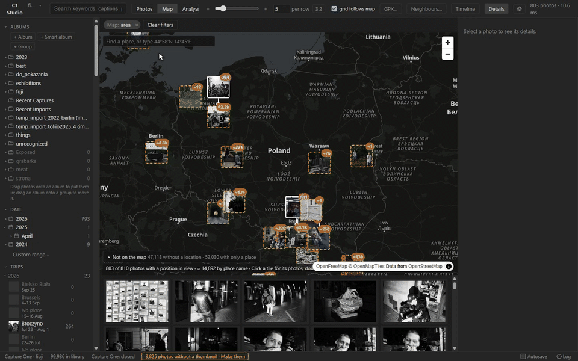

[In the guide: Map](GUIDE.md#map)

## No location, plus codes, map and grid in sync

*New in 0.6.0.* **Places › No location** shows the photos with nothing in the Location
field (click again for those with one), and with a city known, the Location field offers
only that city's locations. A Google plus code is taken wherever GPS is typed: a full one,
a short one near the photo or the map's middle, or a short one with a town. With *sync grid
and map* on, a photo's pin picks it in the grid, and the photo picked in the grid centres
the map; the details panel shows a photo's plus code.

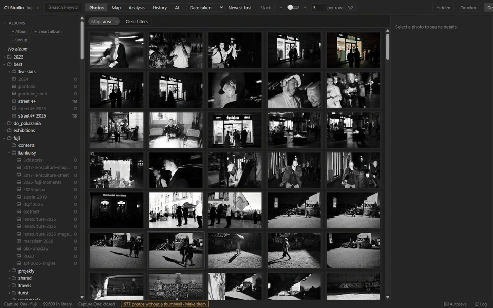

[In the guide: Map](GUIDE.md#map)

## Places from neighbours in time

*New in 0.4.0.* Photos taken moments apart were taken in the same place. **Neighbours…**
gives the photos with no position, or only a ≈ one from their place's name, a position
from the GPS photos shot just before and after, if it lies in the photo's own place. A
photo placed only in *London* takes *London › Barbican* from a neighbour, even past
others that only say London, as long as no neighbour says somewhere else. You see the
counts and every from → to before anything changes, and Ctrl+Z undoes it.

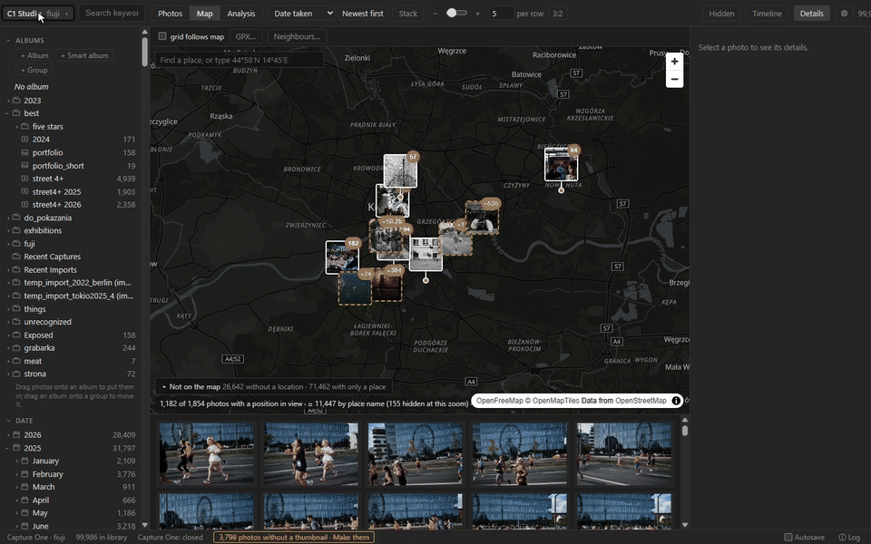

[In the guide: Map](GUIDE.md#map)

## Trips and the timeline

Trips are found from when and where the photos were taken, and named after their places.
Rename, merge, split or keep them, or make an album of one. The timeline shows photos per
day, week or month with the trips under the bars: drag across it to pick days.

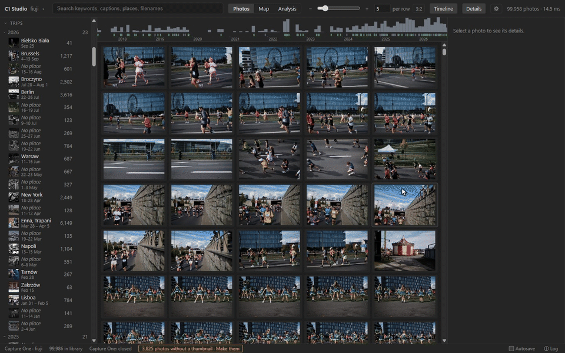

[In the guide: Trips and the timeline](GUIDE.md#trips-and-the-timeline)

## Write, history and backups

Writing makes a backup of the catalog first, and any backup can be restored from the app.
Every change to the catalog is recorded, whether it was made here, in Capture One, by a
GPX import or by restoring a backup, and the details panel shows each photo's history.
The History tab shows all of it over time: [History: the catalog over time](#history-the-catalog-over-time).

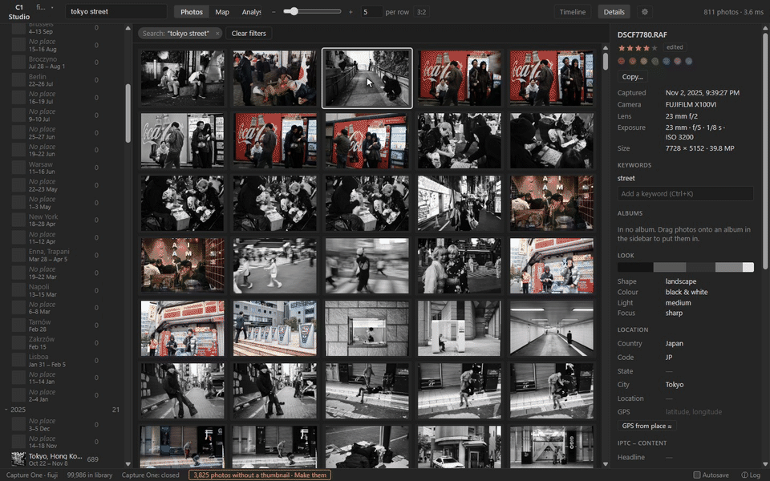

[In the guide: Writing to Capture One](GUIDE.md#writing-to-capture-one)

## History: the catalog over time

The History tab draws the library as photos imported per day, with a line for the running
total and a row of marks for the days the change log saw changes. Drag across it to pick
days and it compares them: how many photos changed (a rating set and set back is not a
change), which fields, the keywords gained and lost, and the albums photos went into and
out of. Every number shows those photos in the grid. Under it, the change log in groups, so
"rating changed on 1,240 photos" is one row you can click.

Not wanted? *Settings › History* turns the tab off for a catalog: the change log then
keeps only the changes themselves, as before, and the app does no history work.

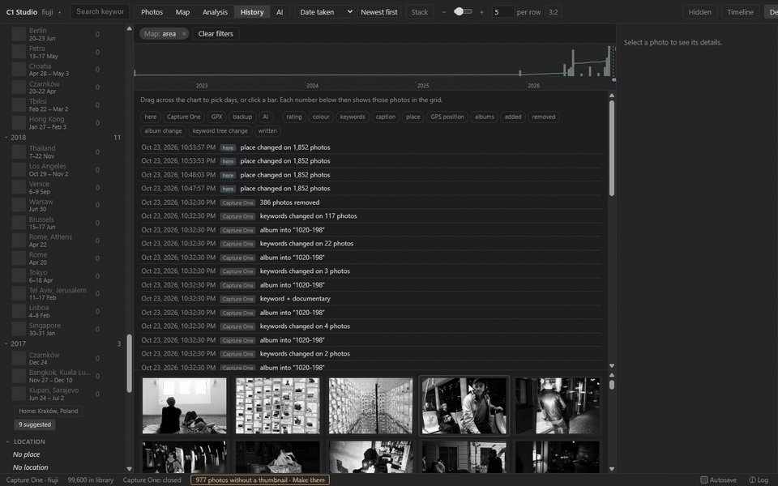

[In the guide: History](GUIDE.md#history)

## Describe photos with AI

Pick photos and the **AI** tab asks a vision model about them: Claude (with an API key, or
on your Claude plan through Claude Code) or Gemini (through agy, on your Google account).
Each photo comes back as a card to review: a caption, a headline, keywords chosen from your
own vocabulary and a few new ones, a rating, and the place level by level with how likely
each is. Tick what fits and accept it; it becomes edits in the queue like any of yours, and
what the photo already has is replaced only when you tick it. Gemini can take contact
sheets of 36 photos in one call for a quick first pass, and **Details** shows each call as
it goes, down to the sheet that was sent.

*New in 0.11.0:* keywords from a model on your own computer. SigLIP 2, downloaded once,
looks at each photo in about a quarter of a second, with no account, no cost and no photo
leaving the machine. It offers keywords only. *Learn from the rest* has it look once at the
photos you keyworded by hand; a photo is then offered the keywords of the keyworded photos
most like it, so it comes to know your names, places and private words.

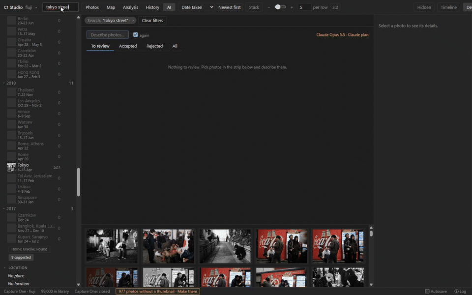

[In the guide: Describing photos with AI](GUIDE.md#describing-photos-with-ai)

## Correct the AI, and teach it

*New in 0.7.0.* Fix a card before accepting it: rename a place level from the catalog's
own names (the levels above fill in), add keywords the model missed, give another rating.
Every card accepted or rejected is kept under **Reviewed** with what you changed. **Refine
the prompt** sends those corrections to Claude, which turns them into lessons such as
*write Polish region names in Polish*; keep the ones you like and the next run follows
them.

[In the guide: Describing photos with AI](GUIDE.md#describing-photos-with-ai)

## Find where photos were taken

*New in 0.9.0.* **Locate**, in the AI tab, asks the model only where a photo was taken:
the place level by level with how likely each is, a position with how far off it may be,
and the landmark or clues it rests on. The catalog helps: the photos with GPS taken before
and after, the places written on photos around it, its trip and home. A guess the
photographer could not have reached in time is held down. Photos taken one after another
at one place go as one scene, on one sheet, and are placed together. Only photos with no
position of their own are located; real GPS is never touched.

**AI guesses** on the map shows each guess as a purple pin with a circle as wide as it may
be off. Click one to accept or reject it, or drag it to where the photo really was. A
landmark recognised for certain becomes the photo's own position; anything less is marked
≈ and stays on the map where the guess put it.

- **Why a photo wasn't placed:** the card says *No place found* with the model's reason, the
  landmark and clues it saw; a photo placed in part says what kept the rest open. The run's
  log gives one line per photo, sheet or scene, and `events.log` each photo's reason and
  clues. An answer in prose is quoted rather than reported as unreadable.
- **Whole scenes:** a scene's card opens to show all its photos, not just the first nine.
- **Show on map** from a card opens the map on the guess with the card's photos picked: a
  guess to review at its pin, its card open to accept, reject or drag; a reviewed one at
  the area of its position; one with no position at the place it names.
- **AI-placed positions** accepted as approximate show in their own violet, clustered apart
  from GPS, or not at all (*Settings › Map*); the map's note counts them either way.

[In the guide: Describing photos with AI](GUIDE.md#describing-photos-with-ai)

---

The recordings are made by scripts that drive the app, so they can be made again when it
changes: see [tools/record](../tools/record/README.md).
