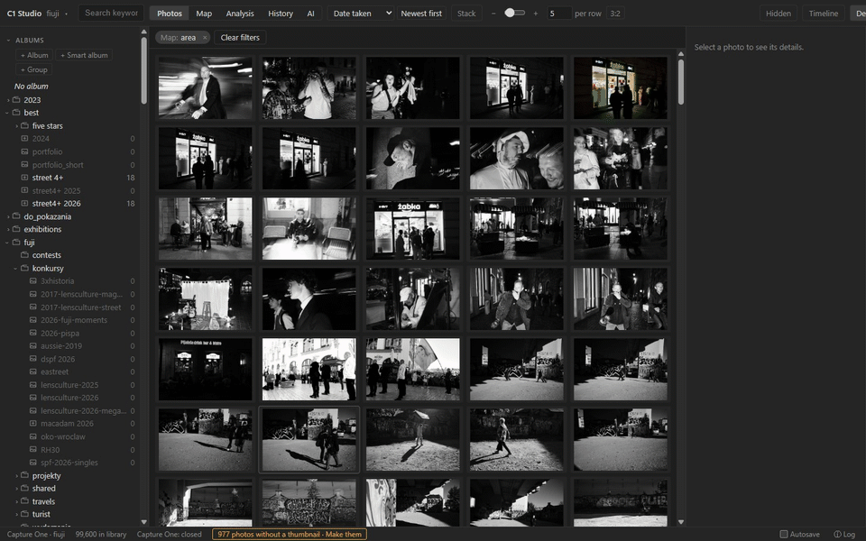
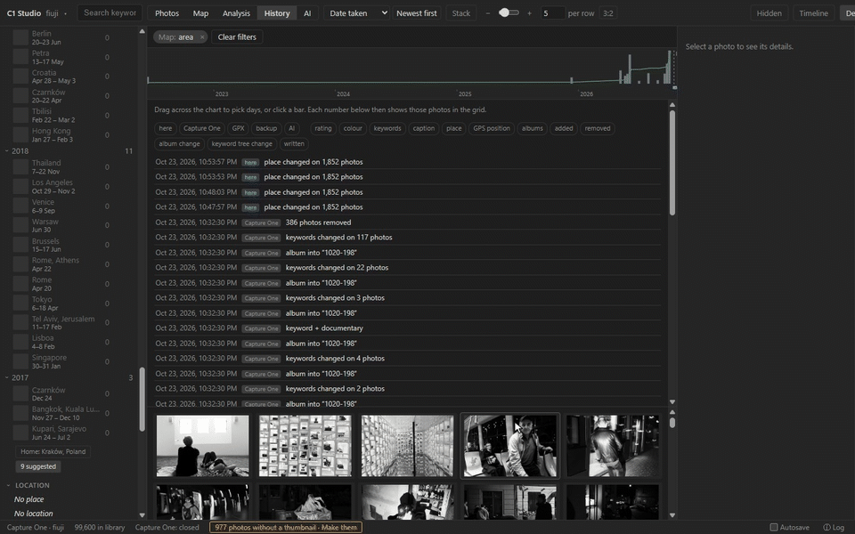
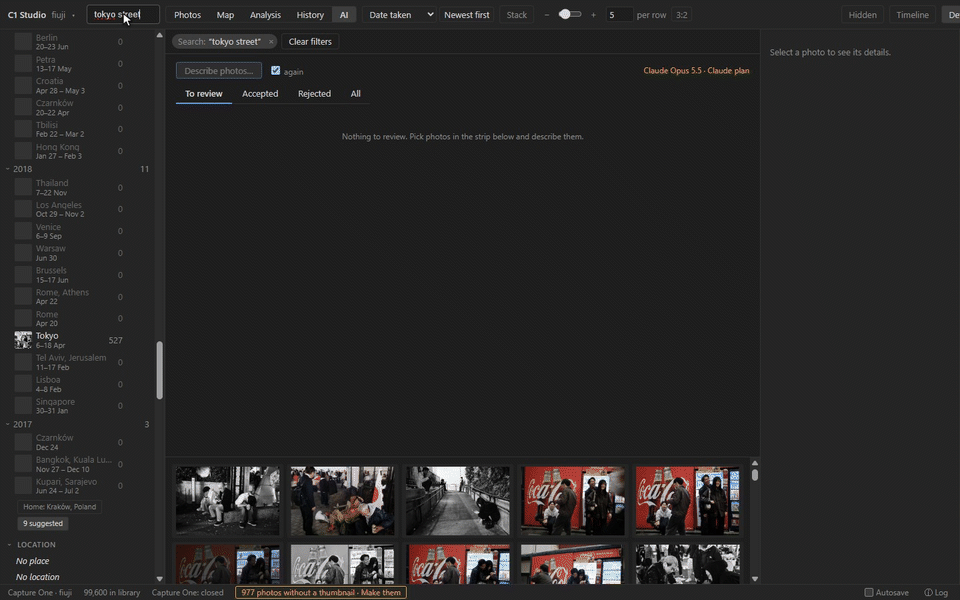

# C1 Studio features

What C1 Studio does, one feature at a time, each with a short recording of the app on a
real catalog of 100,000 photos. The [user guide](GUIDE.md) has the details.

New in 0.7.0: [the selection through filters, Back and Forward](#the-selection-through-filters-back-and-forward),
[photos around a photo](#photos-around-a-photo) and [AI suggestions corrected, and lessons](#correct-the-ai-and-teach-it). New in 0.6.0: [describe photos with AI](#describe-photos-with-ai),
[History](#history-the-catalog-over-time) and [plus codes, map and grid in sync](#no-location-plus-codes-map-and-grid-in-sync). New in 0.5.0: [delete, with a trash](#delete-with-a-trash). New in 0.4.0:
[photo folders](#photo-folders) and [places from neighbours in time](#places-from-neighbours-in-time).

- [Find anything, instantly](#find-anything-instantly)
- [Photo folders](#photo-folders)
- [Browse](#browse)
- [The selection through filters, Back and Forward](#the-selection-through-filters-back-and-forward)
- [Photos around a photo](#photos-around-a-photo)
- [Sort](#sort)
- [The best match first](#the-best-match-first)
- [Edit, then write](#edit-then-write)
- [Hide sensitive photos](#hide-sensitive-photos)
- [Delete, with a trash](#delete-with-a-trash)
- [The keyword tree](#the-keyword-tree)
- [Albums and smart albums](#albums-and-smart-albums)
- [See what your photos look like](#see-what-your-photos-look-like)
- [Duplicates, bursts and stacking](#duplicates-bursts-and-stacking)
- [On the map](#on-the-map)
- [No location, plus codes, map and grid in sync](#no-location-plus-codes-map-and-grid-in-sync)
- [Places from neighbours in time](#places-from-neighbours-in-time)
- [Trips and the timeline](#trips-and-the-timeline)
- [Write, history and backups](#write-history-and-backups)
- [History: the catalog over time](#history-the-catalog-over-time)
- [Describe photos with AI](#describe-photos-with-ai)
- [Correct the AI, and teach it](#correct-the-ai-and-teach-it)

## Find anything, instantly

Type to search keywords, captions, places and file names, and narrow down with albums,
dates, folders, keywords, rating, colour tag, camera, lens and place. Every count in the
sidebar follows as you go, and each filter shows as a chip above the grid. Queries take
milliseconds, however big the catalog.

[In the guide: Finding photos](GUIDE.md#finding-photos)

## Photo folders

*New in 0.4.0.* Open plain folders of JPEG, PNG, TIFF and camera raw files the way you
open a Capture One catalog: here, 1,350 photos in a Google Drive folder. EXIF, XMP and
IPTC are read from the files, and your ratings, keywords and places are kept in C1
Studio's own store. They go into the files only if you turn XMP export on. A photo keeps
its edits when its file is moved or renamed, and a drive that is not connected marks its
photos offline instead of losing them. The installer, and *Kinds of source…* in the
source menu, choose whether the app offers catalogs, folders or both.

[In the guide: Photo folders](GUIDE.md#photo-folders)

## Browse

A resizable grid, a details panel with everything about the photo, and a full-screen
viewer, showing each photo as Capture One renders it: its thumbnails and previews, with
your edits and crop.

[In the guide: Browsing](GUIDE.md#browsing)

## The selection through filters, Back and Forward

*New in 0.7.0.* Change the filter and the picked photos stay picked, wherever the new one
still shows them; the footer says how many it leaves out, with **Show them**. When an
edit empties the filter (Kraków photos given Warszawa as their city), the filter follows
the photos to their new values instead of leaving an empty grid. **‹ ›** in the header, or
Alt+← and Alt+→, go back and forward through the filters, each with its picks.

[In the guide: Finding photos](GUIDE.md#finding-photos)

## Photos around a photo

*New in 0.7.0.* *Around* in the details panel shows the photos taken near this one: its
**shoot** (one after another, no gap over 30 minutes), ±15 minutes, ±1 hour, ±3 hours or
the whole day, with the photo still picked. Shift+click picks them in the grid instead,
and `t` shows the shoot of the focused photo.

[In the guide: Finding photos](GUIDE.md#finding-photos)

## Sort

Sort by date taken, rating, colour label, import, file name, sharpness or brightness,
with a button that says which way ("Newest first", "Lowest first") and turns it round.

[In the guide: Sorting](GUIDE.md#sorting)

## The best match first

Pick colours, light or focus and **Best match** puts the photos that fit them best
first: the reddest and bluest, the darkest, the sharpest. With picks in several cards the
scores are averaged; *worst match first* turns it round. The ranking is part of the
search, so it is as fast as any other order.

[In the guide: Sorting](GUIDE.md#sorting)

## Edit, then write

Rate, colour-tag and keyword one photo or many, with a key or in the details panel.
Location, GPS and IPTC fields too, and copying fields from one photo to others. Edits
show at once and wait in a queue: nothing reaches Capture One until you write them, or
Autosave does. Ctrl+Z undoes any of them.

[In the guide: Editing](GUIDE.md#editing)

## Hide sensitive photos

Press `h` to keep photos out of every view and every count: the grid, the map, the
timeline, trips and the analysis. *Hidden* in the header shows them again, marked, and
`h` brings them back. The mark is C1 Studio's own: Capture One never sees it.

[In the guide: Hidden photos](GUIDE.md#hidden-photos)

## Delete, with a trash

**Delete** moves photos to C1 Studio's trash, out of every view; Ctrl+Z or *Restore* brings
them back. Nothing is deleted until you empty the trash: then a photo folder's files go to
the Windows Recycle Bin, and a Capture One catalog marks the images deleted, so they show
in Capture One's own Trash.

[In the guide: Trash](GUIDE.md#trash)

## The keyword tree

Find a keyword among thousands, and right-click it to rename it, join it with others,
group it under a parent, or ungroup it. Every photo carrying it follows, as one edit.

[In the guide: Keyword tree](GUIDE.md#keyword-tree)

## Albums and smart albums

Make albums, smart albums and groups, drag photos into albums and albums into groups.
A smart album is a rule (keyword, rating, year), so it holds whatever matches it, now and
later, and is counted by it.

[In the guide: Albums](GUIDE.md#albums)

## See what your photos look like

Every photo is measured once, from its thumbnail: its shape, main colours, brightness,
light problems (clipped highlights, blocked shadows, low contrast) and focus. Each value
is a filter, and each card says what it measures. Picks in a card mean any of them, or,
switched to *all*, every one: red **and** blue. A colour counts when it covers a share of
the photo, or when the photo has a vivid patch of it (a red coat on a grey street), as
you choose in Settings, where every line can be moved and the counts preview as you go.
The details panel says why a photo is red, bright or sharp.

[In the guide: Look](GUIDE.md#look)

## Duplicates, bursts and stacking

Duplicates (one moment saved twice) and series (bursts) are found across the whole
library and listed together, sorted by size, date or sharpness. **Stack** shows one photo
per burst in the grid, its sharpest, without ever hiding a frame that matches your
filter when its sharpest does not.

[In the guide: Look](GUIDE.md#look)

## On the map

Photos with GPS are clustered on a map that works as a filter: pan and zoom, and the grid
shows what is in view, or Shift+drag a box. Find places by name or coordinates. Photos
with only a city or country show at that place, marked ≈. Drag photos onto the map to
place them, import a GPX track, or take positions from the photos shot just before and
after. Drag the line under the map to give the photo strip more room.

[In the guide: Map](GUIDE.md#map)

## No location, plus codes, map and grid in sync

*New in 0.6.0.* **Places › No location** shows the photos with nothing in the Location
field (click again for those with one), and with a city known, the Location field offers
only that city's locations. A Google plus code is taken wherever GPS is typed: a full one,
a short one near the photo or the map's middle, or a short one with a town. With *sync grid
and map* on, a photo's pin picks it in the grid, and the photo picked in the grid centres
the map; the details panel shows a photo's plus code.

[In the guide: Map](GUIDE.md#map)

## Places from neighbours in time

*New in 0.4.0.* Photos taken moments apart were taken in the same place. **Neighbours…**
gives the photos with no position, or only a ≈ one from their place's name, a position
from the GPS photos shot just before and after, if it lies in the photo's own place. A
photo placed only in *London* takes *London › Barbican* from a neighbour, even past
others that only say London, as long as no neighbour says somewhere else. You see the
counts and every from → to before anything changes, and Ctrl+Z undoes it.

[In the guide: Map](GUIDE.md#map)

## Trips and the timeline

Trips are found from when and where the photos were taken, and named after their places.
Rename, merge, split or keep them, or make an album of one. The timeline shows photos per
day, week or month with the trips under the bars: drag across it to pick days.

[In the guide: Trips and the timeline](GUIDE.md#trips-and-the-timeline)

## Write, history and backups

Writing makes a backup of the catalog first, and any backup can be restored from the app.
Every change to the catalog is recorded, whether it was made here, in Capture One, by a
GPX import or by restoring a backup, and the details panel shows each photo's history.
The History tab shows all of it over time: [History: the catalog over time](#history-the-catalog-over-time).

[In the guide: Writing to Capture One](GUIDE.md#writing-to-capture-one)

## History: the catalog over time

The History tab draws the library as photos imported per day, with a line for the running
total and a row of marks for the days the change log saw changes. Drag across it to pick
days and it compares them: how many photos changed (a rating set and set back is not a
change), which fields, the keywords gained and lost, and the albums photos went into and
out of. Every number shows those photos in the grid. Under it, the change log in groups, so
"rating changed on 1,240 photos" is one row you can click.

Not wanted? *Settings › History* turns the tab off for a catalog: the change log then
keeps only the changes themselves, as before, and the app does no history work.

[In the guide: History](GUIDE.md#history)

## Describe photos with AI

Pick photos and the **AI** tab asks a vision model about them: Claude (with an API key, or
on your Claude plan through Claude Code) or Gemini (through agy, on your Google account).
Each photo comes back as a card to review: a caption, a headline, keywords chosen from your
own vocabulary and a few new ones, a rating, and the place level by level with how likely
each is. Tick what fits and accept it; it becomes edits in the queue like any of yours, and
what the photo already has is replaced only when you tick it. Gemini can take contact
sheets of 36 photos in one call for a quick first pass, and **Details** shows each call as
it goes, down to the sheet that was sent.

[In the guide: Describing photos with AI](GUIDE.md#describing-photos-with-ai)

## Correct the AI, and teach it

*New in 0.7.0.* Fix a card before accepting it: rename a place level from the catalog's
own names (the levels above fill in), add keywords the model missed, give another rating.
Every card accepted or rejected is kept under **Reviewed** with what you changed. **Refine
the prompt** sends those corrections to Claude, which turns them into lessons such as
*write Polish region names in Polish*; keep the ones you like and the next run follows
them.

[In the guide: Describing photos with AI](GUIDE.md#describing-photos-with-ai)

---

The recordings are made by scripts that drive the app, so they can be made again when it
changes: see [tools/record](../tools/record/README.md).
